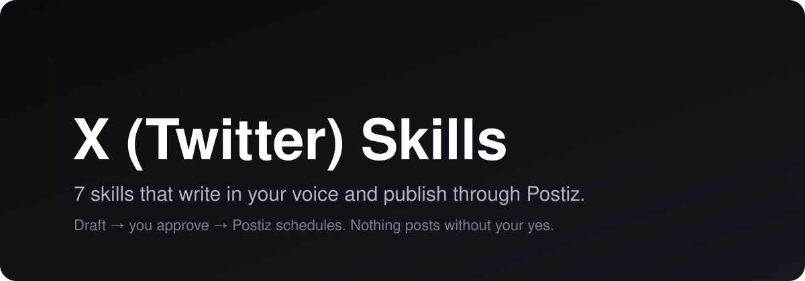

<p align="center">
  
</p>

# X (Twitter) Skills for Claude Code, Claude.ai and Codex

<p align="center">
  
  
  
  
  
</p>

**Claude skills for X (Twitter).** 7 skills that plan, write, scrub and publish your X (Twitter) content. They draft in your voice, strip the AI tells, and hand finished posts to [Postiz](https://postiz.com) for scheduling, only after you approve. No coding required.

> **On another platform too?** Matching bundles: [LinkedIn](https://github.com/mrvsubstack/linkedin-skills) · [Instagram](https://github.com/mrvsubstack/instagram-skills) · [Threads](https://github.com/mrvsubstack/threads-skills) · [YouTube](https://github.com/mrvsubstack/youtube-skills) · [Facebook](https://github.com/mrvsubstack/facebook-skills) · [TikTok](https://github.com/mrvsubstack/tiktok-skills) · [Pinterest](https://github.com/mrvsubstack/pinterest-skills) · [Reddit](https://github.com/mrvsubstack/reddit-skills). Same voice rules, same approve-before-publish flow.

> **Want the full library?** These are a free sample of the Mr V Skills library: 240+ skills for writing, newsletters, offers, ads, SEO and research. [Get it on Substack →](https://promptwithjason.substack.com)

## Install

### Claude.ai (web) or Claude Desktop

1. Click **Customize** in the sidebar and open **Plugins**
2. **Add** → **Add marketplace** → **Add from a repository**
3. Paste `mrvsubstack/x-skills` and sync
4. Open **Discover**, find **x-skills**, click **+** to install
5. Start a new chat and ask for a X (Twitter) post

> Plugins need a paid Claude plan with code execution turned on.

### Claude Code

```
/plugin marketplace add mrvsubstack/x-skills
/plugin install x-skills@x-skills
```

Or clone it and open the folder. The `.claude/skills/` folder points at every skill, so they load with no install:

```bash
git clone https://github.com/mrvsubstack/x-skills.git
cd x-skills
```

### Any agent (Codex, Cursor and others)

```bash
npx skills add mrvsubstack/x-skills
```

Or point your agent at `skills/*/SKILL.md`. Each one is plain markdown.

> **Found this useful? [Star the repo](https://github.com/mrvsubstack/x-skills).** It's how the next person finds it.

## What you can do

Ask in plain English. The right skill picks itself.

**Write a post:**
> "Write 3 tweets about the pricing mistake I made last month."

**Build a thread:**
> "Turn these notes into a thread with a strong first tweet: [paste]"

**Reply with value:**
> "Draft a reply to this post that adds something: [paste]"

**Plan the week:**
> "Give me a weekly X plan for a newsletter writer in the AI niche."

**Ship it:**
> "Schedule the thread on X via Postiz at the next free slot."

Every skill shows you a draft first. Nothing goes out until you say yes.

## The 7 skills

| Skill | What it does |
|---|---|
| **Post Writer** (`x-post-writer`) | Writes a single tweet (or a 2–3 tweet mini-thread) using a hook picked by the reaction you want — replies, reposts, likes or bookmarks — inside the 280-character limit, scrubbed of AI tells and delivered copy-ready with options. |
| **Thread Builder** (`x-thread-builder`) | Builds an X (Twitter) thread that gets read to the end: tweet 1 as a specific promise plus an open loop, the strongest beat up front, one beat per tweet, each tweet able to stand alone, and a closing tweet built for the repost — delivered tweet by tweet with character counts. |
| **Reply Drafter** (`x-reply-drafter`) | Drafts 1–3 replies or a quote tweet for a specific X (Twitter) post that add something real — an answer, a data point, a field note, a sharper question — and tells you whether to reply or quote. Delivered copy-ready to post yourself. |
| **Content Planner** (`x-content-planner`) | Builds a 7-day X (Twitter) plan: daily tweets with hook and goal, which days get a thread, a single-to-thread mix, and daily reply and quote-tweet targets, with a balance check across replies, reposts, likes and bookmarks. |
| **Profile Optimizer** (`x-profile-optimizer`) | Audits an X (Twitter) profile the way a stranger sees it in two seconds — display name, handle, bio, photo, header, pinned post and link — and rewrites each weak part so profile visits turn into follows. |
| **Humanizer** (`x-humanizer`) | Strips the patterns that make a tweet or thread read machine-written — AI word clusters, reveal bridges, fragment stacks, stacked triples, performed honesty — while keeping the writer's edge and quirks. Three modes: Rewrite (default), Audit (pass/fail before posting: 280 fit, first 8 words, links, close) and Profile (learn your voice from 3–6 past tweets). |
| **Postiz Publisher** (`x-postiz-publisher`) | Checks a finished post against X (Twitter)'s rules, shows you an approval card, and schedules it through Postiz after you say yes. Saves a copy-ready file when Postiz isn't set up. |

Some skills suggest companion skills from the other platform bundles or from the [full Mr V library](https://promptwithjason.substack.com) (for example `voice-profile-bank` or `final-edit-modes`). They're optional. Without them, each skill still does its whole job.

## Publish with Postiz

By default the skills hand you a copy-ready post. Connect [Postiz](https://postiz.com) and Claude can schedule it for you.

**Why Postiz:** it's open source, you can self-host it for free, and one account covers X (Twitter) plus 25+ other channels. The hosted plan works too.

**Setup (5 minutes):**

1. Create a Postiz account (or self-host it) and connect X (Twitter) under **Add Channel**.
2. Copy your API key from **Settings** → **Public API**.
3. Save it as an environment variable, not in the chat:
   ```bash
   export POSTIZ_API_KEY="your-key"
   # self-hosted only:
   export POSTIZ_API_URL="https://your-domain/api/public/v1"
   ```
4. Restart Claude and ask: **"List my Postiz channels."**

Full guide: [`skills/x-postiz-publisher/references/postiz-setup.md`](skills/x-postiz-publisher/references/postiz-setup.md).

**How a post ships:**

1. A writer skill drafts the post.
2. You edit until you like it.
3. `x-postiz-publisher` checks it against X (Twitter)'s limits and shows an approval card: account, local time and UTC, media, exact text.
4. You say yes. It schedules through Postiz and gives you the post id.

No key? It saves the post to `post-ready-to-paste.txt` instead. Nothing breaks.

**Not published through Postiz:** Replies and quote posts. The reply drafter hands you a copy-ready block.

## Voice rules every skill follows

1. A number or a statement in line 1. Never open on a question.
2. Odd precision beats round numbers: "$4,730" reads like a receipt, "$5k" like a guess.
3. One real detail per post. If you didn't give one, the skill asks. It never invents one.
4. No stock AI words (leverage, robust, elevate, navigate, foster, delve).
5. No reveal bridges ("Here's the thing", "Plot twist:") and no staccato stacks ("Simple. Fast. Done.").
6. Em dashes capped at about one per 100 words.

## Troubleshooting

| Problem | Fix |
|---|---|
| Skills don't activate | Start a new chat after installing. In Claude Desktop, check the plugin is listed under **Yours**, not only **Discover**. |
| "Postiz isn't connected" | `POSTIZ_API_KEY` isn't visible to Claude. Set it in your shell profile, open a new terminal, restart Claude. |
| 401 from Postiz | The key is wrong or was regenerated. Copy it again from Settings → Public API. |
| 429 from Postiz | You hit Postiz's hourly posting limit. Wait and try again. |
| X (Twitter) channel not found | Connect it in the Postiz dashboard, or reconnect it if it shows as disabled. |
| Validation error on a post | A required platform setting is missing. The publisher reads the error and asks you for it. |

## Credits and license

Several skills here were rewritten in Mr.V's own words from methods in Serge Bulaev's MIT-licensed [x-skills](https://github.com/sergebulaev/x-skills). See [CREDITS.md](CREDITS.md).

MIT licensed. See [LICENSE](LICENSE). Not affiliated with X (Twitter) or Postiz.

Made by **Mr.V** · [Substack](https://promptwithjason.substack.com)
